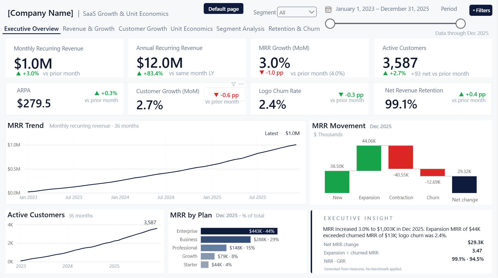
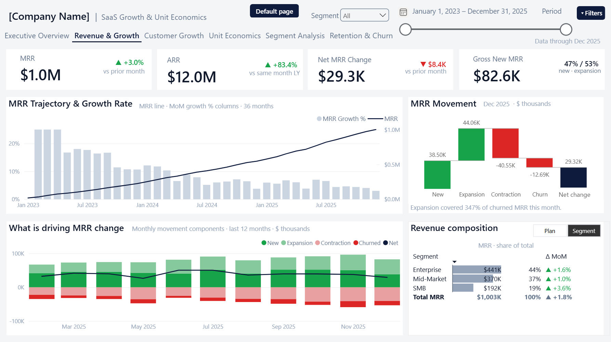
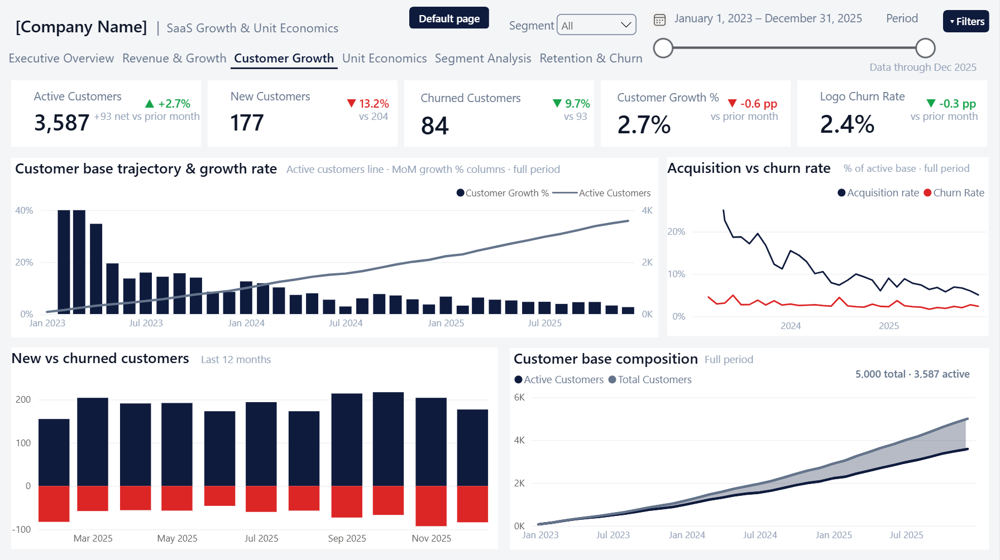
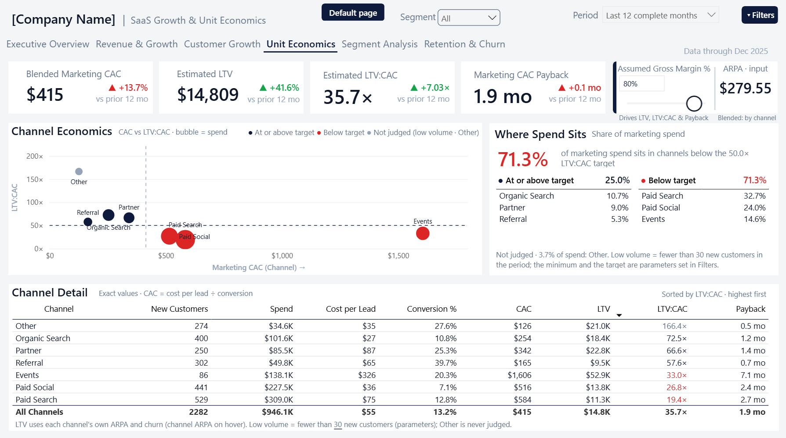
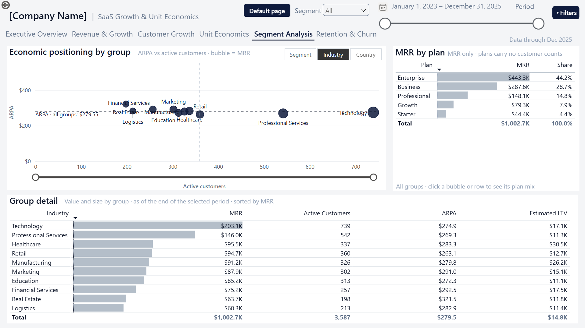
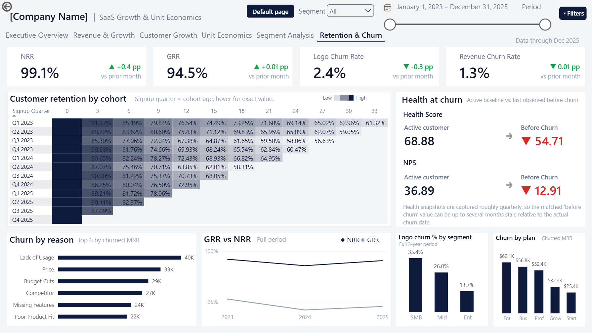

# 📈 SaaS Growth & Unit Economics

### **$12M ARR. 99.1% net revenue retention. And a third of SMB customers already gone.**

**Six Power BI pages that answer every question a SaaS board asks — from one model, on any client's data.**

`Power BI` · `DAX` · `Power Query` · `Reusable .pbit template`

---

## 🧩 The Problem

**Growing fast and growing profitably are different things — and most SaaS companies can only measure the first.**

Revenue sits in accounting. Acquisition cost sits with marketing. Churn sits in the CRM. Each number is true alone and useless beside the others, so the questions that decide the next quarter go unanswered:

> *Is our growth getting more expensive?* · *Are we keeping the customers we paid to win?* · *Which segments deserve more?*

This template answers all three from one model — and because the source file is a parameter, not a hardcoded path, it points at the next client's data without being rebuilt.

**Built for** SaaS founders, operators and finance leads — and BI professionals judging whether a "template" really is one.

---

## 📊 What It Answers

| Question | The answer, on the page |
| --- | --- |
| How are we performing overall? | MRR **$1.0M** · ARR **$12.0M** · **3,587** customers · NRR **99.1%** |
| What's moving revenue? | New **+$38.5K** · Expansion **+$44.1K** · Contraction **−$40.6K** · Churn **−$12.7K** → **+$29.3K** |
| Are we winning faster than we're losing? | **177 new** vs **84 churned** — but **1,413** of 5,000 are already gone |
| Is growth economically efficient? | CAC **$415**, payback **1.9 months** — yet **71.3% of spend** misses the LTV:CAC target |
| Who actually drives the business? | Enterprise = **44.2% of MRR** · Technology = **$203.1K** across 739 customers |
| Are we keeping what we win? | GRR **94.5%** · NRR **99.1%** · retention **88.8% at 3 months → 61.1% at 30** |

---

## 🖼 The Six Pages

### 1 · Executive Overview — *How is the business performing?*



Eight KPIs, the MRR trend, the movement waterfall and a written insight card. One screen, nothing to click.

---

### 2 · Revenue & Growth — *What's driving MRR movement?*



The growth-rate decline shown against the MRR line that causes it. Expansion covered **347%** of churned MRR this month.

---

### 3 · Customer Growth — *Is acquisition outpacing loss?*



Acquisition against churn on one axis. The shaded band is the gap between 5,000 customers ever won and 3,587 still here — the cumulative cost of churn.

---

### 4 · Unit Economics — *Is the growth we're buying worth it?*



CAC against LTV:CAC, bubble = spend. **71.3% of marketing spend** sits below target. Gross margin, target ratio and minimum volume are **adjustable parameters on the page**, not constants buried in a measure.

---

### 5 · Segment Analysis — *Which customer groups carry the business?*



ARPA against customer count, switchable between **Segment · Industry · Country** from one field parameter — so volume-driven and value-driven groups separate on sight.

---

### 6 · Retention & Churn — *Who leaves, and what did they look like first?*



A twelve-quarter cohort heatmap, plus the health profile of customers *before* they churned: **68.88 → 54.71** health score, **36.89 → 12.91** NPS.

---

## 💡 What the Data Says

- **📉 A falling growth rate that isn't bad news.** MRR went ~$18.9K → **$1.0M** in three years. Growth fell from 50%+ to **3.0%** because the base grew 53×, not because the business stalled.
- **⚖️ Expansion is covering churn, with 4.6 points to spare.** NRR **99.1%** vs GRR **94.5%**. That gap is the entire buffer — if expansion slows, revenue shrinks before one extra customer leaves.
- **🎯 Acquisition cost spans 13×.** **$126** to **$1,606** per customer. Paid Search and Paid Social take **56.7% of spend** at the two worst returns; Referral converts at **39.7%** for **$165**.
- **🏢 Small customers leave three times as often.** SMB **35.4%** · Mid-Market **26.0%** · Enterprise **13.7%** — and Enterprise carries 44.2% of MRR.
- **⏱️ Churn is front-loaded.** **88.8%** retained at 3 months, **81.0%** at 6, **61.1%** at 30. Nearly all the damage happens before month six.

---

## 🔬 Why It's a Template, Not a Dashboard

| | |
| --- | --- |
| **Parameterised source** | `SourceFilePath` Power Query parameter — repointed at a different file and refreshed end-to-end, not assumed |
| **Relative dates** | Every period measure anchors to `MAX(DimDate[Date])`. No `TODAY()`, no hardcoded dates |
| **Dynamic categories** | `RANKX`-based Top-N on live measures — no hardcoded channel, plan or segment lists |
| **One metric, one home** | A frozen ownership matrix: each metric has one canonical measure and one page. Repeats are documented, never drift |
| **180 measures** | 53 business metrics plus the delta / colour / caption sets behind an identical KPI card on every page — [`measures.dax`](powerbi/measures.dax) |

<details>
<summary><b>The modelling decision everything else follows from</b></summary>

<br>

MRR isn't stored. It's a running total of a signed event ledger:

```dax
MRR =
CALCULATE (
    SUM ( FactSubscriptionEvent[MRRChange] ),
    FILTER ( ALL ( DimDate ), DimDate[Date] <= MAX ( DimDate[Date] ) )
)
```

Every New, Expansion, Contraction and Churn event carries a signed `MRRChange`, so the running total *is* the subscription base at any date — which is why the waterfall reconciles to the MRR line by construction rather than by agreement.

It also means `GRR` and `Revenue Churn Rate` are **not** arithmetic inverses, despite looking like they should be: GRR carries contraction, revenue churn doesn't. That's why Page 6 has four KPI cards, not three.

Every formula: **[docs/METRIC_DEFINITIONS.md](docs/METRIC_DEFINITIONS.md)**

</details>

---

## ⚠️ Limitations

- **🧪 Synthetic data.** Seeded simulation, Jan 2023 – Dec 2025. No figure describes a real business.
- **📐 LTV is model-dependent.** `ARPA × margin ÷ smoothed churn` returns a blended LTV:CAC of **35.7×** on this data — an artefact of low simulated churn, **not a benchmark**. Use it to rank channels against each other, never as an absolute.
- **💰 CAC is marketing-only.** Excludes sales salaries, commissions and onboarding. Fully-loaded CAC would be higher — which is why the pages say "Marketing CAC".
- **🔗 Association, not causation.** Churn reasons are recorded categories, not explanations.
- **📌 Page 4's Top-N cutoff is synchronised by hand** across three visuals — Power BI can't apply a measure-based filter at page level.

Full detail, deferred work and maintenance notes: **[docs/LIMITATIONS.md](docs/LIMITATIONS.md)**

---

## ✅ Validation

Seven production-readiness steps — measure validation, functional QA, interactions, performance, accessibility, data-contract testing and template packaging.

| | Result |
| --- | --- |
| **180 measures audited** | Each assigned a home page and a status: `Validated`, `Needs Re-test` or `Unverified` |
| **GRR** | 94.5% live, matching an independent hand-derivation of 94.53% |
| **Cohort retention** | Cross-confirmed by two independently-reasoned methods |
| **Health before churn** | Two definitions tested; last-snapshot-before-churn adopted and confirmed at **54.71 / 12.91** |
| **`SourceFilePath`** | Repointed at a different file and refreshed — the claim that makes this a template |

<details>
<summary><b>What is <i>not</i> closed — the boundary matters more than the passes</b></summary>

<br>

- **Not every measure is live-confirmed.** The inventory marks these `Unverified` rather than assuming them correct.
- **No automated harness.** This is documented human verification, not a re-runnable script. The dataset generator isn't published here, so the figures **can't be independently recomputed from this repo alone.**
- **Report-layer behaviour verified by inspection** — tooltips, cross-filter settings and conditional formatting checked by hand in Power BI Desktop.
- **One open binding check** remains logged (Page 5's share re-summing under a three-option field parameter).

</details>

Full report: **[docs/VALIDATION.md](docs/VALIDATION.md)**

---

## 🚀 How to Use

**Read it** — the six images above are the whole analysis. Nothing to install.

**Open it** — download [`powerbi/SaaS_Growth_Unit_Economics.pbit`](powerbi/) and **double-click it** (not File → Open — the double-click triggers the parameter prompt). Give it the path to [`data/SaaS_Growth_Unit_Economics_Dataset.xlsx`](data/), hit **Load**, and all six pages populate.

**Run it on your own data** — seven sheets matching the documented contract. Schema, content rules and first-run checklist: **[docs/SETUP.md](docs/SETUP.md)**.

---

## 📁 Repository

| | |
| --- | --- |
| **[powerbi/](powerbi/)** | The `.pbit` template · 180-measure DAX export · report theme |
| **[images/](images/)** | All six pages |
| **[data/](data/)** | Synthetic workbook — 7 tables, 5,000 customers, 19,532 events, 36 months |
| **[docs/](docs/)** | [Metrics](docs/METRIC_DEFINITIONS.md) · [Data dictionary](docs/DATA_DICTIONARY.md) · [Architecture](docs/ARCHITECTURE.md) · [Validation](docs/VALIDATION.md) · [Limitations](docs/LIMITATIONS.md) · [Setup](docs/SETUP.md) |
| **[docs/page-sops/](docs/page-sops/)** · **[docs/qa-records/](docs/qa-records/)** | Per-page build SOPs · the seven QA step records, unedited |

---

## 📜 Licence

**MIT** — template, DAX, documentation and synthetic data alike. See [LICENSE](LICENSE).

---

## 👤 Author

**Yisak Fikre** — Microsoft Certified Data Analyst · Power BI Developer

[](https://www.upwork.com/freelancers/~018f77b25aa92fd189?mp_source=share)
[](https://www.linkedin.com/in/yisak-fikre-b806361bb/)
[](https://github.com/yisakfikre)
[](mailto:yisakfikre@outlook.com)

**More:** [Gross Margin Bridge](https://github.com/yisakfikre/Gross-Margin-Bridge-Report) · [Sales Analysis Report](https://github.com/yisakfikre/Sales-Analysis-Report) · [Marketing Campaign Performance](https://github.com/yisakfikre/Marketing-Campaign-Performance-Report)
